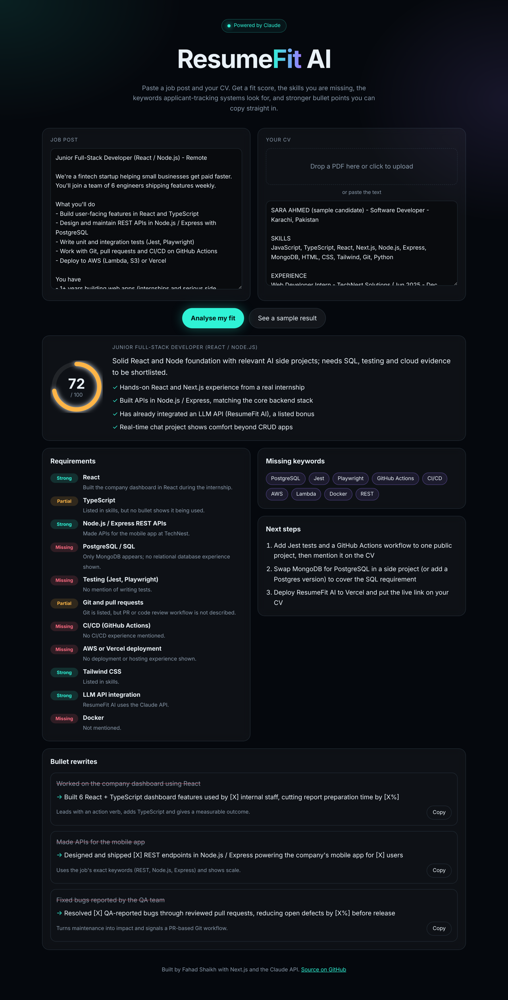

# ResumeFit AI

**Paste a job post and your CV. Claude scores the fit, shows which requirements you meet, lists the ATS keywords you're missing, and rewrites your weakest bullet points.**



## Features

- **Fit score (0-100)** with a one-line recruiter verdict and your top strengths
- **Requirement breakdown**: every key skill in the job post marked *Strong*, *Partial* or *Missing*, with the evidence from your CV
- **Missing ATS keywords** that applicant-tracking systems will look for
- **Bullet rewrites** using strong verbs, the job's own keywords and measurable results, with one-click copy. Unknown numbers become `[X%]` placeholders, so nothing is invented
- **PDF or text CV**: PDFs are sent to Claude as a document, so layout and tables survive
- **Sample mode**: click *See a sample result* to explore the UI without an API key

## How it works

```
Browser (React)  ──FormData──▶  /api/analyze (Next.js route)  ──▶  Claude API
                                    │                               │
                                    │  Zod schema → JSON Schema     │ structured output
                                    ◀───────── typed Analysis ◀─────┘
```

1. The route builds one request: the CV (PDF `document` block or text) plus the job post.
2. It calls `client.messages.parse()` with a **Zod schema** (`lib/schema.ts`) as the output format, so Claude must return valid JSON in exactly that shape. No regex parsing, no "please answer in JSON".
3. Adaptive thinking lets the model reason about the match before it answers. Effort is set to `medium` to keep latency and cost sensible.
4. The typed result is rendered by `app/page.tsx`.

Errors are handled by type (rate limit, bad key, refusal, other API errors) and shown to the user in plain language.

## Tech stack

Next.js 16 (App Router) · React 19 · TypeScript · Zod · Anthropic TypeScript SDK (`claude-opus-5-5`)

## Run it locally

```bash
git clone https://github.com/FahadAsad10/resumefit-ai.git
cd resumefit-ai
npm install
cp .env.example .env.local   # then add your ANTHROPIC_API_KEY
npm run dev                  # http://localhost:3000
```

## Deploy

Deploy to Vercel in one click: import the repo and add `ANTHROPIC_API_KEY` as an environment variable.

## Project structure

```
app/
  api/analyze/route.ts   # Claude call, validation, error handling
  page.tsx               # UI: form, score ring, results
  globals.css
lib/
  schema.ts              # Zod schema = the contract with the model
  sample.ts              # Sample job, CV and result for demo mode
```

## Ideas for next steps

- Cover-letter generator from the same analysis
- Compare one CV against several jobs at once
- Export the improved CV as a PDF

## License

MIT, built by Fahad Shaikh with [Claude Code](https://claude.com/claude-code).
